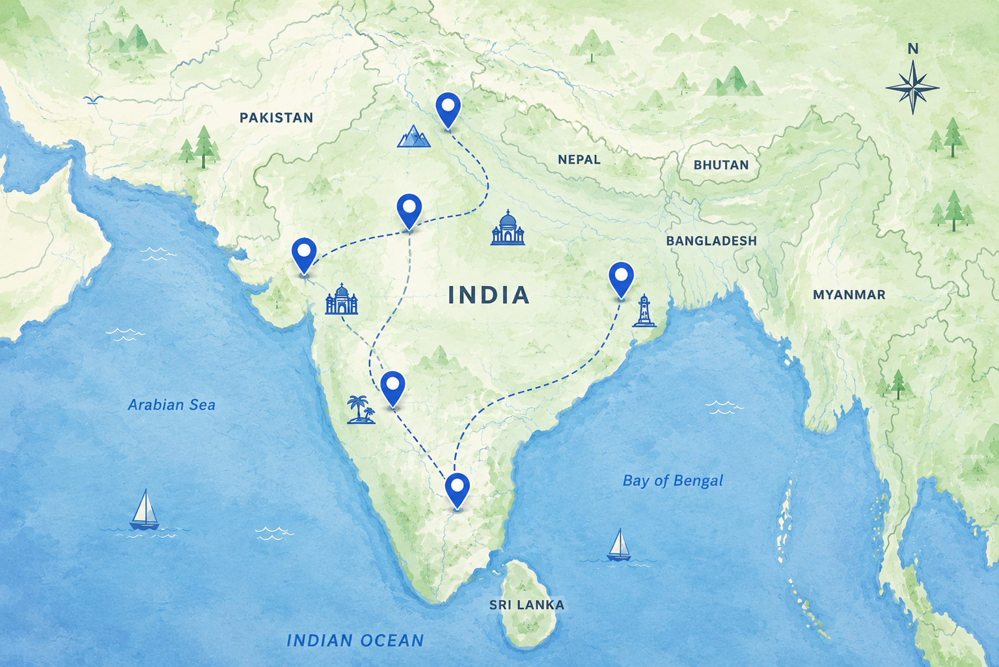

<div align="center">

# ✈️ KIBI

### Your journey. Smarter planned.

**A modern travel planner that turns scattered travel research into one organized journey.**

<br>

[](https://kibi-mu.vercel.app/)
[](https://github.com/Bhargav-bit567/Kibi)
[](https://vercel.com/)

<br>

<a href="https://kibi-mu.vercel.app/">
  
</a>

<br><br>

**Discover → Plan → Organize → Explore**

<br>

[🌍 **Try Kibi Live**](https://kibi-mu.vercel.app/)

</div>

---

# 🌍 The Problem

Planning a trip sounds simple.

Actually planning one usually means opening **multiple websites, maps, notes, booking platforms, and spreadsheets** just to organize a few days.

Travelers have to figure out:

* 📍 Where to go
* 🗓️ What to do each day
* 💰 How much the trip might cost
* 🏨 Where to stay
* 🍜 What to eat
* 🗺️ Which places are worth visiting
* 📝 How to keep everything organized

The information exists.

**The problem is that it's scattered.**

> **Trip planning shouldn't feel like project management.**

Kibi brings the planning experience into one place.

---

# 💡 What is Kibi?

**Kibi is a web-based travel planner designed to help users discover destinations, create trips, organize itineraries, and manage their journeys from one interface.**

Instead of jumping between different tools, users can move through a simple flow:

```text
Discover
   ↓
Choose a destination
   ↓
Plan the trip
   ↓
Build the itinerary
   ↓
Save the journey
   ↓
Explore
```

The goal is simple:

> **Less time organizing the trip. More time experiencing it.**

---

# ✨ What Makes Kibi Different?

Kibi isn't trying to be another booking platform.

It focuses on the **planning layer between inspiration and the actual journey.**

### 🔎 Discover

Find destinations and explore places that could become part of your journey.

### 🧳 Plan

Create a trip around your destination, dates, preferences, and travel style.

### 🗓️ Organize

Turn a collection of places into a structured day-by-day itinerary.

### 🗺️ Explore

Use visual destination information to understand where places fit into your journey.

### 📊 Manage

Keep multiple trips organized through a dedicated trip dashboard.

---

# 🚀 Key Features

| Feature                      | What it does                                         |
| ---------------------------- | ---------------------------------------------------- |
| 🌍 **Destination Discovery** | Browse destinations and discover travel inspiration  |
| 🗓️ **Trip Planner**         | Create trips based on destination and travel details |
| 🧭 **Itinerary Builder**     | Organize activities and destinations day by day      |
| 📍 **Destination Maps**      | Visualize destinations and places                    |
| 📊 **Trip Dashboard**        | Manage planned and saved journeys                    |
| 💾 **Local Persistence**     | Preserve trip data using browser local storage       |
| 🔐 **Authentication UI**     | Login and signup experience                          |
| 🌙 **Dark Mode**             | Switch between light and dark themes                 |
| 📱 **Responsive UI**         | Designed for desktop, tablet, and mobile screens     |

---

# 🧭 User Journey

A typical Kibi workflow looks like this:

```text
                 ✈️ START
                    │
                    ▼
            🌍 DISCOVER
                    │
                    ▼
          📍 DESTINATION
                    │
                    ▼
             📅 DATES
                    │
                    ▼
          🎯 PREFERENCES
                    │
                    ▼
             🧳 PLAN
                    │
                    ▼
          🗓️ ITINERARY
                    │
                    ▼
             💾 SAVE
                    │
                    ▼
           🌎 EXPLORE
```

The interface is designed around keeping this journey simple and visual.

---

# 📸 Product Preview

## 🌍 Discover

Explore destinations and start building travel inspiration.

<div align="center">


</div>

---

## 🗺️ Explore

Visualize destinations and places that can become part of your trip.

<div align="center">



</div>

---

## 🧳 Plan Your Journey

Create the details of your trip and organize the journey.

<div align="center">


</div>

---

# ⚙️ How Kibi Works

Kibi is built as a client-side web application.

```text
                ┌─────────────────┐
                │      User       │
                └────────┬────────┘
                         │
                         ▼
                ┌─────────────────┐
                │   HTML Pages    │
                │ Discover / Plan │
                │ Itinerary / etc │
                └────────┬────────┘
                         │
                         ▼
                ┌─────────────────┐
                │  JavaScript     │
                │ Application      │
                │ Logic            │
                └────────┬────────┘
                         │
              ┌──────────┴──────────┐
              ▼                     ▼
       ┌──────────────┐      ┌──────────────┐
       │ LocalStorage │      │   UI State   │
       └──────────────┘      └──────────────┘
```

The application separates reusable functionality into modules for:

* Authentication
* Storage
* Trip management
* Destination matching
* Shared UI components
* Theme management

---

# 🛠️ Tech Stack

<div align="center">


</div>

### Core Technologies

**HTML5**
Page structure and semantic markup.

**Tailwind CSS**
Responsive styling and UI design.

**Vanilla JavaScript**
Application logic, interactions, state management, and dynamic rendering.

**Local Storage**
Client-side persistence for trips and user data.

**Git & GitHub**
Version control and project management.

**Vercel**
Production deployment and hosting.

---

# 📁 Project Structure

```text
Kibi/
│
├── index.html                 # Landing page
├── discover.html              # Destination discovery
├── plan-trip.html             # Trip planner
├── itinerary.html             # Generated itinerary
├── my-trips.html              # User's trips
├── dashboard.html             # Dashboard & statistics
├── saved-itinerary.html       # Saved itineraries
│
├── login.html                 # Login
├── signup.html                # Signup
│
├── js/
│   ├── app.js                 # Navbar, footer & theme
│   ├── auth.js                # Authentication logic
│   ├── storage.js             # Local storage management
│   ├── trips.js               # Trip rendering & management
│   └── matching.js            # Destination matching
│
├── assets/
│   └── ...                    # Images, icons & other assets
│
├── server.py                  # Local development server
│
└── README.md
```

---

# ⚡ Getting Started

## 1. Clone the repository

```bash
git clone https://github.com/Bhargav-bit567/Kibi.git
```

## 2. Enter the project

```bash
cd Kibi
```

## 3. Run locally

You can open `index.html` directly in your browser.

For development, using **VS Code Live Server** or another local HTTP server is recommended.

Alternatively:

```bash
python server.py
```

Then open the local address shown by the server.

---

# 🌐 Live Demo

Kibi is currently deployed and available online:

### 👉 https://kibi-mu.vercel.app/

**Try the application:**
🌍 **[Launch Kibi](https://kibi-mu.vercel.app/)**

---

# 📌 Current Status

Kibi currently provides the core travel-planning experience:

* ✅ Destination discovery
* ✅ Trip creation
* ✅ Itinerary organization
* ✅ Trip dashboard
* ✅ Saved trip data
* ✅ Responsive interface
* ✅ Light / dark mode
* ✅ Client-side persistence
* ✅ Deployed production version

The project is intentionally structured so additional travel intelligence and external services can be integrated later.

---

# 🗺️ Roadmap

The next stage of Kibi is focused on making the planner more intelligent and useful.

### 🤖 Intelligence

* [ ] AI-generated personalized itineraries
* [ ] Preference-based destination recommendations
* [ ] Intelligent activity scheduling
* [ ] Automatic itinerary optimization

### 🌦️ Real-world Data

* [ ] Live weather information
* [ ] Real-time maps
* [ ] Hotel discovery
* [ ] Flight discovery
* [ ] Restaurant recommendations
* [ ] Attraction recommendations

### 💰 Trip Management

* [ ] Advanced travel budget
* [ ] Expense tracking
* [ ] Cost estimation
* [ ] Budget-aware recommendations

### 👥 Collaboration

* [ ] Cloud-based trip synchronization
* [ ] Collaborative trip planning
* [ ] Shared itineraries
* [ ] Multi-user trips

### 📱 Platform

* [ ] Progressive Web App
* [ ] Offline support
* [ ] Expanded destination database

---

# 🎯 Project Vision

Kibi started with a simple question:

> **What if planning a trip felt as exciting as taking one?**

The long-term vision is to evolve Kibi from a traditional trip planner into an **intelligent travel companion**.

Instead of starting with:

```text
"I want to travel somewhere."
```

and spending hours figuring everything out...

Kibi should eventually be able to turn that idea into:

```text
"Here's your journey."
```

with the destination, itinerary, activities, budget, and practical information intelligently organized around the traveler.

---

# 🧠 Why Kibi?

Travel planning has plenty of information.

What it lacks is **coordination**.

Kibi is built around the idea that a good travel experience should connect:

```text
Inspiration
     ↓
Destination
     ↓
Preferences
     ↓
Itinerary
     ↓
Budget
     ↓
Journey
```

rather than forcing the traveler to coordinate everything manually.

---

# 📈 Future Direction

The most important evolution of Kibi is moving from:

**Static planning → Intelligent planning**

Future versions can combine:

* User preferences
* Destination data
* Maps
* Weather
* Budget constraints
* Opening hours
* Travel time
* Personal interests

to generate journeys that aren't just **possible**, but actually **practical**.

---

# 🤝 Contributing

Contributions, ideas, and feedback are welcome.

If you find a bug or have an idea for improving Kibi:

1. Open an issue
2. Describe the problem or idea
3. Submit a pull request if you'd like to contribute

---

<div align="center">

# ✈️ KIBI

### Don't just plan a trip. Build a journey.

**Discover → Plan → Explore → Remember**

<br>

🌍 **[Try Kibi Live](https://kibi-mu.vercel.app/)**

⭐ If you like the project, consider giving the repository a star.

<br>

Made with ☕, code, and a little bit of wanderlust.

</div>
